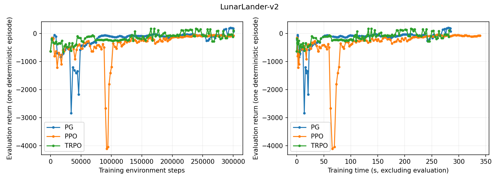
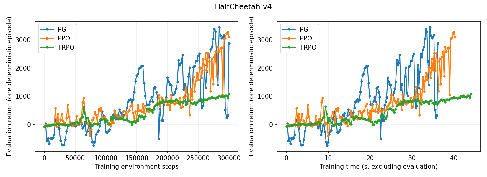
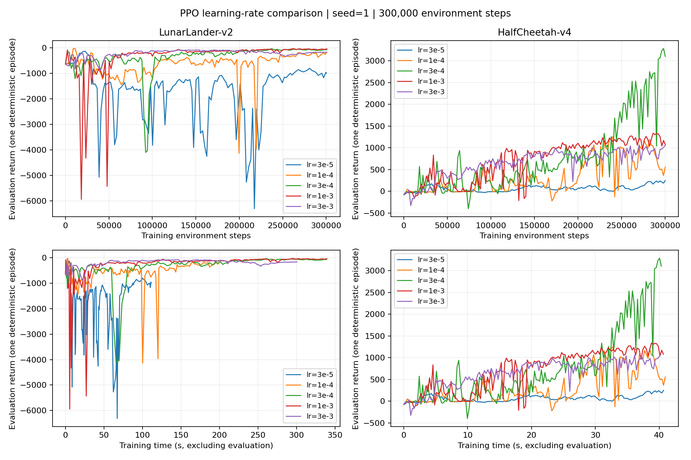

# 策略梯度实验结果

每组约 30 万环境交互步，seed=1，单线程 CPU。每次评估固定一局，采用最大概率动作或高斯均值；回报越高越好。以下为最终回报，已取整。

共同设置：两层 64 单元 tanh 网络，γ=0.99，GAE λ=0.95，价值 baseline、优势归一化；每轮至少采样 512 步，收完整轨迹。

## 算法对比

PG：学习率 `3e-3`；PPO：学习率 `3e-4`、clip=0.2、5 epochs、minibatch=256；TRPO：max KL=0.01。

| 环境 | PG | PPO | TRPO |
|---|---:|---:|---:|
| LunarLander-v2 | 77 | -67 | **113** |
| HalfCheetah-v4 | 2881 | **3103** | 1082 |

本次 HalfCheetah 上，TRPO 曲线较平稳；PG、PPO 波动更大，但后期回报更高。





## PPO 学习率对比

仅改变 actor 学习率，其余设置相同。

| 学习率 | LunarLander-v2 | HalfCheetah-v4 |
|---|---:|---:|
| `3e-5` | -991 | 248 |
| `1e-4` | -183 | 557 |
| `3e-4` | -67 | **3103** |
| `1e-3` | **-45** | 1079 |
| `3e-3` | -170 | 1057 |

学习率更小不一定更稳定；曲线更平也可能只是停在低回报。此次 HalfCheetah 以 `3e-4` 最好，LunarLander 以 `1e-3` 略好。



## 运行

```bash
uv run python src/scripts/compare_algorithms.py
uv run python src/scripts/compare_algorithms.py --ppo-lrs 3e-5 1e-4 3e-4 1e-3 3e-3
```

单 seed、单局评估，仅用于建立直觉，不代表算法的一般排名。
